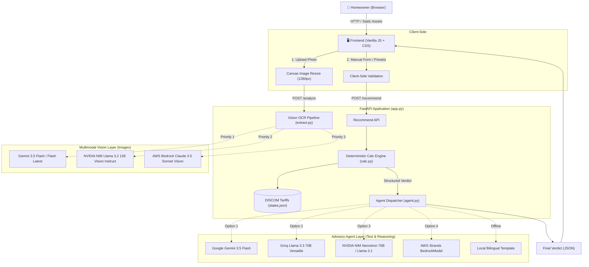

# ☀️ SuryaSetu
### *Smart Rooftop Solar Savings Calculator & AI Energy Advisor for Indian Homes*

[](https://www.python.org/)
[](https://fastapi.tiangolo.com/)
[](https://github.com/awslabs/)
[](https://github.com/)
[](https://pytest.org/)
[](LICENSE)

---

## 📌 Overview

**SuryaSetu** is an end-to-end, production-ready web application designed to help Indian homeowners assess rooftop solar feasibility under the **PM Surya Ghar: Muft Bijli Yojana (2025–2026)**.

By simply uploading an electricity bill photo or entering consumption numbers, homeowners receive:
- **Optimal System Sizing (kW)** customized to their rooftop and local solar irradiation.
- **Direct Benefit Transfer (DBT) Subsidy** calculations under PM Surya Ghar norms.
- **Before vs. After Bill Comparison** based on real progressive DISCOM tariff slabs.
- **Payback Timeline & Concessional Green Loan EMI** estimates.
- **AI Energy Advisory** generated in **English** or **Hindi (हिंदी)**.

---

## 🚀 Key Features

### 1. 🧮 100% Deterministic Financial Calculation Engine (`calc.py`)
- **Strict Separation of Concerns:** Math and financial calculations are executed entirely by deterministic Python code—**never left to LLM hallucination**.
- **Real Indian DISCOM Tariffs:** Pre-configured slab rates for **Maharashtra (MSEDCL)**, **Rajasthan (JVVNL/AVVNL/JdVVNL)**, **Uttar Pradesh (UPPCL)**, and **Delhi (BSES/TPDDL)**, with an automated national average fallback.
- **PM Surya Ghar Subsidy Modeling:**
  - ₹30,000 / kW for the first 2 kW
  - ₹18,000 / kW for the 3rd kW
  - Capped at ₹78,000 for systems ≥ 3 kW
- **Reverse Slab Inversion ("Amount-Only" Mode):** If a user only knows their total bill amount (e.g., ₹3,850), the engine inverts the progressive piecewise tariff function to accurately estimate units consumed.
- **Concessional Solar Loan EMI:** Standard 10-year bank loan modeled at 5.75% p.a. under priority sector clean-energy lending.

### 2. 🤖 Multi-Provider Agent Architecture (`agent.py`)
- Built on the design principles of **AWS Strands Agents** (`strands-agents`), AWS's official open-source AI agent framework.
- **Universal LLM Support (Free & Commercial):**
  - 🌟 **Google Gemini:** `gemini-3.5-flash` / `gemini-flash-latest` (free tier via Google AI Studio)
  - ⚡ **Groq:** `llama-3.3-70b-versatile` (free tier via GroqCloud)
  - 🟢 **NVIDIA NIM:** `meta/llama-3.2-11b-vision-instruct` / `nvidia/llama-3.1-nemotron-70b-instruct` (free tier via build.nvidia.com)
  - ☁️ **AWS Bedrock:** `anthropic.claude-3-5-sonnet` (via AWS Strands BedrockModel)
  - 🛡️ **Offline Fallback:** 100% offline, deterministic bilingual templates guaranteeing **zero downtime**.

### 3. 📷 Multimodal Bill Photo OCR (`extract.py`)
- **Upload or Capture Bills:** Supports camera snapshots and file uploads (JPEG, PNG, WEBP) of any Indian electricity bill.
- **Client-Side Image Preprocessing:** HTML5 Canvas automatically downscales high-res mobile photos to max 1280px before upload, cutting payload sizes by ~85% for lightning-fast inference.
- **Updated Production Vision Models for Images:**
  - 🌟 **Google Gemini Vision (`gemini-3.5-flash` / `gemini-flash-latest`):** The primary free vision engine via the official `google-genai` SDK. Fast, high-resolution visual understanding tailored for Indian DISCOM billing formats (*MSEDCL, UPPCL, BSES, JVVNL, BESCOM*). Replaces discontinued `gemini-2.0-flash` with automatic fallback to `gemini-flash-latest` and `gemini-3.8-flash`.
  - 🟢 **NVIDIA NIM Vision (`meta/llama-3.2-11b-vision-instruct`):** Free-tier open multimodal vision instruct model served via NVIDIA's OpenAI-compatible NIM endpoint (`https://integrate.api.nvidia.com/v1`). Excels at dense tabular document reading, tariff slab extraction, and numeric meter OCR. *(Note: uses multimodal vision instruct rather than diffusion generation models like Qwen-Image which lack OCR capabilities).*
  - ☁️ **AWS Bedrock Claude 3.5 Sonnet Vision (`anthropic.claude-3-5-sonnet-20241022-v2:0`):** Enterprise-grade multimodal extraction powered by the AWS Bedrock Converse API with native byte-level image encoding.
  - 🛡️ **Fault-Tolerant Vision Fallback Chain:** If the primary vision provider encounters rate limits or errors, the parser seamlessly falls back through the remaining configured providers before returning an intuitive manual review prompt.
- **Zero-Hallucination Extraction:** Strictly structured JSON extraction parses: **State code**, **Billed Units (kWh)**, **Billing Days**, **Amount Payable (₹)**, **Sanctioned Load (kW)**, **Fixed Charges (₹)**, and an OCR confidence score. Extracted values pre-populate form fields so users can review before calculating.

### 4. 🎨 Minimalist Apple / Vercel Light UI (`static/`)
- Pure Vanilla JavaScript & CSS (Zero bulky UI frameworks).
- Sticky glassmorphic navigation bar with real-time AI engine status indicator.
- **Instant English ⇋ Hindi (हिंदी) Toggle** translating all labels, presets, form fields, and output reports.
- **1-Click Quick Samples:** Test immediately with 1-click presets (*2 BHK Flat*, *3 BHK + AC*, *Heavy Load*).
- **Interactive Bill Comparison Bar:** Visual dual-track comparison showing current bill vs. solar bill reduction percentage.
- **Bento Grid Dashboard:** Clean metric cards with printable report layout.

---

## 🏛️ System Architecture



---

## 📁 Repository Structure

```
bijli-solar-advisor/
├── app.py                  # FastAPI server, routes, CORS, Starlette 1.x compatibility shim
├── calc.py                 # Pure calculation engine (sizing, tariffs, subsidy, EMI, reverse-slabs)
├── agent.py                # Multi-LLM agent dispatcher (Gemini, Groq, NVIDIA, Bedrock, template)
├── extract.py              # Multimodal bill OCR engine (Gemini Vision, NVIDIA NIM Vision, Bedrock)
├── requirements.txt        # Python package dependencies
├── .env.example            # Environment variables template
├── .env                    # Local API keys (excluded from git)
├── plan.md                 # System architecture specification
│
├── data/
│   └── states.json         # DISCOM tariff slabs & irradiation yields (MH, UP, DL, National)
│
├── static/
│   ├── index.html          # Semantic HTML5 single-page application (bilingual i18n ready)
│   ├── styles.css          # Apple / Vercel minimalist light theme stylesheet
│   └── app.js              # Client logic: form handling, image resize, i18n, verdict rendering
│
└── tests/
    ├── test_calc.py        # 12 unit tests for calculator math & edge cases
    └── test_api.py         # 6 integration tests for FastAPI REST endpoints
```

---

## 🛠️ Installation & Setup

### 1. Prerequisites
- Python **3.10+** (fully verified up to Python 3.14)
- Pip package manager

### 2. Clone & Install Dependencies
```bash
cd "d:\New Project\Hackthon\bijli-solar-advisor"

# Install requirements
pip install -r requirements.txt
```

### 3. Configure API Keys
Create your local `.env` file by copying the example:
```bash
cp .env.example .env
```

Open `.env` and add **any one** (or all) of the free API keys:

```env
# Option 1: Google Gemini (Recommended - Fast OCR for bill images + bilingual reasoning)
# Free at: https://aistudio.google.com/app/apikey
GEMINI_API_KEY=AIzaSy...
GEMINI_VISION_MODEL=gemini-3.5-flash        # Image OCR: gemini-3.5-flash or gemini-flash-latest
GEMINI_MODEL=gemini-3.5-flash               # Text reasoning: gemini-3.5-flash

# Option 2: NVIDIA NIM (Free tier for multimodal Vision & Text)
# Free at: https://build.nvidia.com
NVIDIA_API_KEY=nvapi-...
NVIDIA_VISION_MODEL=meta/llama-3.2-11b-vision-instruct   # Multimodal image OCR for complex bills
NVIDIA_MODEL=nvidia/llama-3.1-nemotron-70b-instruct      # Text reasoning

# Option 3: Groq (Ultra-fast LLM text advisory)
# Free at: https://console.groq.com/keys
GROQ_API_KEY=gsk_...
GROQ_MODEL=llama-3.3-70b-versatile

# Option 4: AWS Bedrock (Claude 3.5 Sonnet for Vision & Strands Agents)
AWS_ACCESS_KEY_ID=AKIA...
AWS_SECRET_ACCESS_KEY=...
AWS_REGION=us-east-1
VISION_MODEL_ID=anthropic.claude-3-5-sonnet-20241022-v2:0

# Photo scanning switch
PHOTO_ENABLED=true
```

> **Note:** Even if no API keys are provided, the application runs **100% offline** using local deterministic templates!

---

## 💻 Running the Application

Start the local server using Uvicorn:
```bash
uvicorn app:app --host 0.0.0.0 --port 8000
```

- Open **`http://localhost:8000`** in your browser.
- Open **`http://<your-laptop-ip>:8000`** on your smartphone connected to the same Wi-Fi to test mobile camera capture!

---

## 🧪 Automated Test Suite

All 18 unit and integration tests run without requiring AWS or external network credentials:

```bash
python -m pytest tests/ -v
```

### Test Coverage Highlights:
- ✅ `test_zero_units`: Verifies system clamps to minimum 1.0 kW.
- ✅ `test_very_high_units`: Verifies system clamps to residential ceiling of 10.0 kW.
- ✅ `test_unknown_state`: Validates fallback to national average tariff and logs clear assumptions.
- ✅ `test_subsidy_cap_at_3kw`: Confirms PM Surya Ghar ceiling of ₹78,000 for systems ≥ 3 kW.
- ✅ `test_amount_only_mode`: Validates reverse-slab inversion round-trip (Amount → kWh → Bill).
- ✅ `test_rooftop_recommendation_always_active`: Confirms rooftop solar sizing and PM Surya Ghar roadmap are generated deterministically.
- ✅ `test_emi_calculation`: Tests loan amortization formula at 5.75% p.a.
- ✅ `test_rajasthan_tariff_and_high_yield`: Verifies Rajasthan DISCOM slabs and high solar irradiation calculation.
- ✅ `test_api_endpoints`: Integration tests for `/`, `/config`, `/recommend`, and validation errors.

---

## 📡 REST API Reference

### `GET /config`
Returns active server feature flags and detected AI provider.
```json
{
  "photo_enabled": true,
  "provider": "gemini"
}
```

### `POST /recommend`
Calculates solar sizing, financials, and generates natural-language explanation.

**Request Body:**
```json
{
  "state": "MH",
  "units_kwh": 450,
  "billing_days": 30,
  "amount_payable": 3850,
  "has_roof": "yes",
  "lang": "en"
}
```

**Response (Sample):**
```json
{
  "system_kw": 3.5,
  "subsidy": 78000,
  "cost": 192500,
  "bill_before": 3850,
  "bill_after": 240,
  "savings_monthly": 3610,
  "savings_annual": 43320,
  "payback_years": 2.6,
  "emi": 1258,
  "explanation": "Based on your electricity usage, we recommend a 3.5 kW rooftop solar system...",
  "checklist": [
    "Register on PM Surya Ghar Portal (pmsuryaghar.gov.in).",
    "Select an empanelled vendor from your DISCOM roster."
  ],
  "assumptions": [
    "Solar generation estimated at 4.2 units per kW per day."
  ]
}
```

### `POST /analyze`
Accepts a multipart file upload and performs multimodal OCR extraction.

---

## 📜 Official Scheme Reference
- **Scheme Name:** PM Surya Ghar: Muft Bijli Yojana
- **Implementing Ministry:** Ministry of New and Renewable Energy (MNRE), Govt. of India
- **National Portal:** [pmsuryaghar.gov.in](https://pmsuryaghar.gov.in)
- **Central Financial Assistance (CFA):**
  - ₹30,000 / kW for capacity up to 2 kW
  - ₹18,000 / kW for additional capacity up to 3 kW
  - Maximum subsidy capped at ₹78,000

---

## 📄 License
This project is open-source under the [MIT License](LICENSE).
